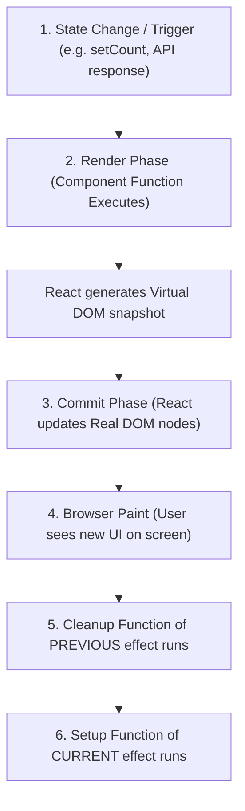

# ⚡ `useEffect` Deep-Dive & The Component Lifecycle: Comprehensive Guide

This comprehensive guide expands **Section 4, `useEffect` Deep-Dive & The Component Lifecycle**, from `03-state-and-lifecycle.md`.

It covers the transition from legacy class lifecycles to modern declarative effects, the browser execution pipeline, dependency array mechanics, cleanup timing, race condition mitigation with `AbortController`, React 18/19 Strict Mode double-invocation, and when **not** to use `useEffect`.

---

## Table of Contents
1. [Core Mental Model: Synchronization, Not Lifecycles](#1-core-mental-model-synchronization-not-lifecycles)
2. [What is a "Side Effect"?](#2-what-is-a-side-effect)
3. [The React Render-Commit-Paint-Effect Pipeline](#3-the-react-render-commit-paint-effect-pipeline)
4. [The Anatomy of `useEffect`](#4-the-anatomy-of-useeffect)
5. [The 3 Dependency Variations (Deep Breakdown)](#5-the-3-dependency-variations-deep-breakdown)
   - [Variation 1: No Dependency Array (`useEffect(() => {})`)](#variation-1-no-dependency-array-useeffect---)
   - [Variation 2: Empty Dependency Array (`useEffect(() => {}, [])`)](#variation-2-empty-dependency-array-useeffect---)
   - [Variation 3: Specific Dependencies (`useEffect(() => {}, [dep1, dep2])`)](#variation-3-specific-dependencies-useeffect---dep1-dep2)
6. [The Cleanup Function: Lifecycle of an Effect](#6-the-cleanup-function-lifecycle-of-an-effect)
   - [When Does Cleanup Actually Run?](#when-does-cleanup-actually-run)
   - [Step-by-Step Lifecycle Trace](#step-by-step-lifecycle-trace)
   - [Common Cleanup Scenarios](#common-cleanup-scenarios)
7. [Handling Asynchronous Logic & Race Conditions](#7-handling-asynchronous-logic--race-conditions)
   - [The Race Condition Problem](#the-race-condition-problem)
   - [Solution 1: `AbortController` (Production Best Practice)](#solution-1-abortcontroller-production-best-practice)
   - [Solution 2: The Boolean Flag (`isMounted` / `ignore`)](#solution-2-the-boolean-flag-ismounted--ignore)
8. [React 18 / 19 Strict Mode: The "Runs Twice" Mystery](#8-react-18--19-strict-mode-the-runs-twice-mystery)
9. [`useEffect` vs `useLayoutEffect`](#9-useeffect-vs-uselayouteffect)
10. [When NOT to Use `useEffect`](#10-when-not-to-use-useeffect)
11. [Class Component Lifecycles vs `useEffect`](#11-class-component-lifecycles-vs-useeffect)
12. [Top 5 Pitfalls, Anti-Patterns & Fixes](#12-top-5-pitfalls-anti-patterns--fixes)
13. [Quick Reference Cheat Sheet](#13-quick-reference-cheat-sheet)

---

## 1. Core Mental Model: Synchronization, Not Lifecycles

In older versions of React (Class Components), developers thought in terms of lifecycle events:
- *"The component just mounted into the DOM -> run this code."*
- *"The component received new props -> run this update code."*
- *"The component is about to unmount -> run this teardown code."*

In modern functional React with Hooks:
> **Stop thinking about when a component mounts, updates, or unmounts.**
> **Start thinking about synchronization with external systems.**

An effect declares:
> *"Whenever state `X` or prop `Y` has value `Z`, make sure the external system (the browser title, a WebSocket connection, a chart canvas, an API server) is **in sync** with that state."*

If the component re-renders and the dependencies haven't changed, the external system is already in sync, so React skips running the effect.

---

## 2. What is a "Side Effect"?

A pure React component is a mathematical function that turns inputs (`props` and `state`) into output (`JSX`):

$$\text{UI} = f(\text{state, props})$$

During this calculation, the function must remain **pure**:
- It should not modify external variables.
- It should produce identical JSX given identical props and state.
- It should have no side effects during the rendering phase.

A **Side Effect** is any operation that reaches outside this pure rendering calculation:

| Side Effect Type | Real-World Example |
| :--- | :--- |
| **Data Fetching** | Requesting doctor lists or patient records via Axios / `fetch` |
| **Subscriptions** | Listening to WebSocket notifications, Firebase listeners, chat rooms |
| **Timers** | `setTimeout`, `setInterval` |
| **Direct DOM Manipulation** | Focusing an input, integrating with D3.js or Leaflet maps |
| **Browser APIs** | Reading/writing `localStorage`, updating `document.title`, geolocation |
| **Logging / Telemetry** | Sending user interaction analytics to Datadog or Google Analytics |

`useEffect` provides a safe, dedicated boundary to perform these external operations **after** React finishes rendering the UI.

---

## 3. The React Render-Commit-Paint-Effect Pipeline

Understanding the exact sequence of events in a render cycle prevents subtle timing bugs:



### Key Takeaways from the Pipeline:
1. **`useEffect` is non-blocking (asynchronous)**:
   It runs **after** the browser paints the screen. This ensures network calls and heavy effect operations do not freeze animations, typing, or user clicks.
2. **The user sees the rendered UI first**:
   If an effect immediately triggers another state update, the user may momentarily see the first state before the second render paints (unless batched or handled via `useLayoutEffect`).

---

## 4. The Anatomy of `useEffect`

```javascript
import { useEffect } from 'react';

useEffect(() => {
  // 1. SETUP CODE:
  // Runs after the browser paints. Connects to or synchronizes with an external system.

  return () => {
    // 2. CLEANUP CODE (Optional):
    // Runs before the effect re-runs with new dependencies, and when the component unmounts.
    // Disconnects or cleans up the external system.
  };
}, [dependency1, dependency2]); // 3. DEPENDENCY ARRAY (Optional)
```

> [!WARNING]
> Never make the effect callback itself an `async` function!
> ```javascript
> // ❌ WRONG (Async functions return a Promise, not a cleanup function!):
> useEffect(async () => {
>   const res = await api.get('/doctors');
> }, []);
> 
> // ✅ CORRECT (Define async function inside or call a promise helper):
> useEffect(() => {
>   async function loadData() {
>     const res = await api.get('/doctors');
>   }
>   loadData();
> }, []);
> ```

---

## 5. The 3 Dependency Variations (Deep Breakdown)

React inspects the second argument of `useEffect` using **shallow equality (`Object.is`)** to decide whether to run the effect.

### Summary Comparison Table:

| Syntax | Dependency Array | Execution Timing | Use Case | Analogy |
| :--- | :--- | :--- | :--- | :--- |
| `useEffect(() => {})` | **Omitted** | Runs after **every single render** | Screen metrics logging, DOM sync | None (continuous watcher) |
| `useEffect(() => {}, [])` | **Empty `[]`** | Runs **once** after initial mount | Initial data fetching, global event listeners | `componentDidMount` + unmount cleanup |
| `useEffect(() => {}, [a, b])` | **Values `[a, b]`** | Runs on mount + whenever `a` or `b` changes | Search filtering, parameterized API calls | `componentDidUpdate` with conditional guard |

---

### Variation 1: No Dependency Array (`useEffect(() => {})`)

Without a dependency array, React executes the effect after **every single render** of the component.

```javascript
useEffect(() => {
  console.log("Component rendered or re-rendered!");
});
```

#### ⚠️ The Infinite Loop Disaster:
If you update state inside an effect without a dependency array:

```javascript
// ❌ CRITICAL BUG: INFINITE RENDER LOOP!
function BadCounter() {
  const [count, setCount] = useState(0);

  useEffect(() => {
    setCount(count + 1); // 1. Updates state
  });                    // 2. State update triggers re-render
                         // 3. Re-render triggers useEffect again -> CRASH!
  return <div>{count}</div>;
}
```

---

### Variation 2: Empty Dependency Array (`useEffect(() => {}, [])`)

An empty array `[]` tells React: *"This effect depends on zero values from the component scope. It never needs to re-synchronize based on props or state."*

```javascript
useEffect(() => {
  console.log("Component mounted into the DOM");

  return () => {
    console.log("Component unmounted from the DOM");
  };
}, []);
```

#### Best For:
1. One-time initial data fetching (e.g. loading user profile or settings).
2. Global browser event listeners (`window.addEventListener('resize', handleResize)`).
3. Establishing long-lived connections (WebSockets, WebRTC).

---

### Variation 3: Specific Dependencies (`useEffect(() => {}, [dep1, dep2])`)

React compares each dependency in the array with its previous value using `Object.is(prevDep, nextDep)`. If **any** dependency changed, the cleanup for the old effect runs, and the new effect executes.

```javascript
function DoctorSearch({ departmentId }) {
  const [searchQuery, setSearchQuery] = useState('');
  const [doctors, setDoctors] = useState([]);

  useEffect(() => {
    // Runs on initial mount, AND whenever departmentId OR searchQuery changes!
    fetchDoctors(departmentId, searchQuery).then(setDoctors);
  }, [departmentId, searchQuery]);

  return (/* JSX */);
}
```

#### ⚠️ The Object / Function Reference Trap:
Because React uses `Object.is()`, passing objects or functions created inside the component body as dependencies causes the effect to run on **every render**:

```javascript
function DoctorProfile({ doctorId }) {
  // ❌ BAD: A brand-new object is created on EVERY render (new memory reference 0x1, 0x2...)
  const filters = { id: doctorId, activeOnly: true };

  useEffect(() => {
    fetchDoctor(filters);
  }, [filters]); // React sees new reference every time -> Infinite re-fetches!
}
```

##### How to Fix:
1. **Pass primitives directly**: `[doctorId]` instead of `[filters]`.
2. **Memoize the object**: `const filters = useMemo(() => ({ id: doctorId }), [doctorId]);`.
3. **Move the object inside the effect**:
   ```javascript
   useEffect(() => {
     const filters = { id: doctorId, activeOnly: true };
     fetchDoctor(filters);
   }, [doctorId]);
   ```

---

## 6. The Cleanup Function: Lifecycle of an Effect

One of the most misunderstood aspects of `useEffect` is **when the cleanup function runs**.

### When Does Cleanup Actually Run?
Many developers assume cleanup only runs when the component unmounts. **This is false.**

> [!IMPORTANT]
> **The cleanup function runs:**
> 1. **Before every re-execution of the effect** with new dependencies (to clean up whatever the *previous* effect set up).
> 2. **When the component finally unmounts** from the DOM.

---

### Step-by-Step Lifecycle Trace

Consider this component fetching messages for a chosen chat room:

```javascript
function ChatRoom({ roomId }) {
  useEffect(() => {
    console.log(`🟢 Connecting to room ${roomId}`);
    const connection = createConnection(roomId);
    connection.connect();

    return () => {
      console.log(`🔴 Disconnecting from room ${roomId}`);
      connection.disconnect();
    };
  }, [roomId]);

  return <div>Room: {roomId}</div>;
}
```

Here is what happens when the user switches rooms from `"general"` to `"cardiology"`, and then leaves the page:

| User Action | React Step | Console Output |
| :--- | :--- | :--- |
| **Initial Render (`roomId = "general"`)** | Component renders with `"general"` | |
| | React paints screen | |
| | Effect 1 runs | `🟢 Connecting to room general` |
| **Prop changes (`roomId = "cardiology"`)** | Component re-renders with `"cardiology"` | |
| | React updates DOM and paints screen | |
| | **Effect 1 Cleanup runs first!** | `🔴 Disconnecting from room general` |
| | Effect 2 Setup runs | `🟢 Connecting to room cardiology` |
| **User navigates away (Unmount)** | Component removed from DOM | |
| | **Effect 2 Cleanup runs** | `🔴 Disconnecting from room cardiology` |

---

### Common Cleanup Scenarios

```javascript
// 1. TIMERS:
useEffect(() => {
  const timerId = setInterval(() => {
    tick();
  }, 1000);

  return () => clearInterval(timerId); // Prevents timer accumulation & memory leaks
}, []);

// 2. DOM EVENT LISTENERS:
useEffect(() => {
  function handleKeyDown(e) {
    if (e.key === 'Escape') closeModal();
  }
  window.addEventListener('keydown', handleKeyDown);

  return () => window.removeEventListener('keydown', handleKeyDown); // Prevents duplicate listeners
}, []);

// 3. WEBSOCKET SUBSCRIPTIONS:
useEffect(() => {
  const socket = io('/hospital-feed');
  socket.on('emergency', handleEmergency);

  return () => {
    socket.off('emergency', handleEmergency);
    socket.disconnect();
  };
}, []);
```

---

## 7. Handling Asynchronous Logic & Race Conditions

### The Race Condition Problem

Imagine a doctor directory search input:
1. User types `"car"` (Request 1 begins, takes 1500ms due to network latency).
2. User quickly types `"cardiology"` (Request 2 begins, takes 200ms).
3. Request 2 finishes first -> displays Cardiology doctors.
4. Later, Request 1 finally finishes -> **overwrites the screen with results for `"car"`!**

The UI is now showing stale data for a query the user already discarded!

---

### Solution 1: `AbortController` (Production Best Practice)

Modern browsers and Axios natively support `AbortController`. When the effect cleans up (because `query` changed or the user left), cancel the in-flight request:

```jsx
import { useState, useEffect } from 'react';
import api from '../utils/api'; // Axios instance

export default function DoctorSearch() {
  const [query, setQuery] = useState('');
  const [doctors, setDoctors] = useState([]);
  const [loading, setLoading] = useState(false);

  useEffect(() => {
    // 1. Create an AbortController instance:
    const controller = new AbortController();

    async function searchDoctors() {
      if (!query.trim()) {
        setDoctors([]);
        return;
      }

      try {
        setLoading(true);
        // 2. Pass signal to Axios or fetch:
        const res = await api.get('/doctors', {
          params: { search: query },
          signal: controller.signal
        });
        setDoctors(res.data);
      } catch (err) {
        // 3. Ignore abort errors (they are intentional cancellations):
        if (err.name === 'CanceledError' || err.name === 'AbortError') {
          console.log('Request was canceled as fresh search was dispatched');
        } else {
          console.error('Fetch error:', err);
        }
      } finally {
        setLoading(false);
      }
    }

    searchDoctors();

    // 4. CLEANUP: Abort the previous pending network call!
    return () => {
      controller.abort();
    };
  }, [query]);

  return (/* JSX */);
}
```

---

### Solution 2: The Boolean Flag (`isMounted` / `ignore`)

If you are using an API client that does not support cancellation:

```javascript
useEffect(() => {
  let ignore = false; // Flag for this render cycle

  async function loadData() {
    const data = await fetchDoctorDetails(doctorId);
    if (!ignore) {
      setDoctor(data); // Only update state if this effect is still active!
    }
  }

  loadData();

  return () => {
    ignore = true; // Flag is flipped when effect re-runs or unmounts
  };
}, [doctorId]);
```

---

## 8. React 18 / 19 Strict Mode: The "Runs Twice" Mystery

In development mode (`<React.StrictMode>`), React intentionally **mounts, unmounts, and re-mounts every component immediately**:

```
Development Mode Execution:
1. Mount component
2. Run Setup Effect
3. Run Cleanup Effect (Simulated unmount!)
4. Run Setup Effect again
```

### Why does React do this?
To **stress-test your cleanups**. React wants to verify that your component can handle being unmounted and re-mounted without breaking or leaking resources. In future versions of React (such as Offscreen API / Activity), React will preserve state while unmounting and re-mounting UI trees in the background.

> [!TIP]
> **Do not remove `<React.StrictMode>` to silence double effects.**
> If your effect breaks when it runs twice, your cleanup function is missing or incomplete! If you properly implement cleanup (like `controller.abort()` or `clearInterval()`), the double-invocation will be completely seamless.

---

## 9. `useEffect` vs `useLayoutEffect`

Both hooks share the exact same signature: `(setup, dependencies) => void`. The difference is **when** they run relative to browser paint:

```
Render Phase -> DOM Updated -> [ useLayoutEffect Runs Synchronously ] -> Browser Paint -> [ useEffect Runs Asynchronously ]
```

| Feature | `useEffect` | `useLayoutEffect` |
| :--- | :--- | :--- |
| **Execution Timing** | **After** browser paint (asynchronous) | **Before** browser paint (synchronous) |
| **Blocks Screen Painting?** | ❌ No (Fast & smooth) | ⚠️ Yes (Can cause UI stutter if slow) |
| **Primary Use Case** | Data fetching, event listeners, subscriptions, timers | Measuring DOM elements (e.g. `getBoundingClientRect()`), tooltip positioning |
| **Risk of Visual Flicker** | Small risk if modifying DOM immediately after paint | Zero flicker (calculates position before paint) |

```javascript
import { useLayoutEffect, useRef, useState } from 'react';

function Tooltip({ targetRect }) {
  const ref = useRef(null);
  const [top, setTop] = useState(0);

  // Measure tooltip height BEFORE the user sees it paint to avoid visual jumping:
  useLayoutEffect(() => {
    const { height } = ref.current.getBoundingClientRect();
    setTop(targetRect.top - height);
  }, [targetRect]);

  return <div ref={ref} style={{ position: 'absolute', top }} />;
}
```

> 🎮 **Interactive Visual Simulator**: Open the [useEffect vs useLayoutEffect Interactive Simulator](./04-useEffect-deep-dive-lifecycle/Useeffect-Vs-Uselayouteffect.html) to step through each phase of the browser paint pipeline and see DOM flicker prevention in action.

---

## 10. When NOT to Use `useEffect`

The official React documentation emphasizes: *"You might not need an Effect."* Overusing `useEffect` leads to tangled state synchronization bugs, unnecessary re-renders, and poor performance.

### 1. Transforming Data for Rendering
```javascript
// ❌ BAD (Causes an unnecessary extra render pass!):
function DoctorList({ doctors }) {
  const [activeDoctors, setActiveDoctors] = useState([]);

  useEffect(() => {
    setActiveDoctors(doctors.filter(d => d.isAvailable));
  }, [doctors]);
}

// ✅ GOOD (Calculate directly during render! Fast & pure):
function DoctorList({ doctors }) {
  const activeDoctors = doctors.filter(d => d.isAvailable);
  // (Or wrap in useMemo if the calculation is computationally heavy)
}
```

### 2. Handling User Actions (Event Handlers)
```javascript
// ❌ BAD:
function AppointmentButton() {
  const [booked, setBooked] = useState(false);

  useEffect(() => {
    if (booked) {
      postBookingToServer();
      showNotification();
    }
  }, [booked]);

  return <button onClick={() => setBooked(true)}>Book</button>;
}

// ✅ GOOD: Put action logic in the event handler!
function AppointmentButton() {
  async function handleBook() {
    await postBookingToServer();
    showNotification();
  }

  return <button onClick={handleBook}>Book</button>;
}
```

### 3. Resetting All State on Prop Change
Instead of watching a prop with an effect to reset inputs, use a React **`key`**:

```jsx
// ✅ GOOD: Changing doctorId completely re-mounts Form with pristine initial state!
<AppointmentForm key={selectedDoctorId} doctorId={selectedDoctorId} />
```

---

## 11. Class Component Lifecycles vs `useEffect`

For developers transitioning from class components:

| Class Lifecycle Method | Modern Functional Equivalent with Hooks |
| :--- | :--- |
| `componentDidMount` | `useEffect(() => { ... }, [])` |
| `componentDidUpdate` | `useEffect(() => { ... }, [dep1, dep2])` |
| `componentWillUnmount` | `useEffect(() => { return () => { ... }; }, [])` |
| `shouldComponentUpdate` | `React.memo(Component, arePropsEqual)` |
| `componentDidCatch` | Class Error Boundary (Functional hook equivalent does not exist yet) |

---

## 12. Top 5 Pitfalls, Anti-Patterns & Fixes

### Pitfall 1: ESLint `react-hooks/exhaustive-deps` Suppression
```javascript
// ❌ DANGEROUS: Stale closure bug! 'count' is frozen at 0 inside the interval:
useEffect(() => {
  const id = setInterval(() => {
    setCount(count + 1); // Reads stale count
  }, 1000);
  return () => clearInterval(id);
  // eslint-disable-next-line react-hooks/exhaustive-deps
}, []);

// ✅ FIX: Use functional state updater:
useEffect(() => {
  const id = setInterval(() => {
    setCount(prev => prev + 1); // Always has fresh state!
  }, 1000);
  return () => clearInterval(id);
}, []); // Safe empty dependency array!
```

### Pitfall 2: Re-creating Helper Functions in the Component Body
```javascript
function Search() {
  const [term, setTerm] = useState('');

  // ❌ Function recreated on every render -> new reference every time!
  function fetchData() { api.get(`/search?q=${term}`); }

  useEffect(() => {
    fetchData();
  }, [fetchData]); // Infinite loop!
}

// ✅ FIX: Move the function INSIDE the effect:
function Search() {
  const [term, setTerm] = useState('');

  useEffect(() => {
    function fetchData() { api.get(`/search?q=${term}`); }
    fetchData();
  }, [term]);
}
```

### Pitfall 3: Forgetting Cleanup on Subscriptions
Creating WebSockets or event listeners without returning a teardown function causes memory leaks and duplicate triggers. Always pair setup with cleanup.

### Pitfall 4: Mutating State Directly Inside an Effect
Always use state setters (`setDoctors`), never direct assignment (`doctors = [...]`).

### Pitfall 5: Chaining Effects (Effect A triggers State B -> triggers Effect B)
Chaining multiple effects causes cascading re-render waves. Compute derived values directly or manage compound state transitions with `useReducer`.

---

## 13. Quick Reference Cheat Sheet

| Task | Pattern |
| :--- | :--- |
| **Run Once on Mount** | `useEffect(() => { setup(); return () => cleanup(); }, [])` |
| **Run on Dependency Change** | `useEffect(() => { sync(id); return () => desync(id); }, [id])` |
| **Cancel API on Change/Unmount** | `const c = new AbortController(); api.get(url, { signal: c.signal }); return () => c.abort();` |
| **Safe Interval** | `const id = setInterval(fn, ms); return () => clearInterval(id);` |
| **Safe Window Listener** | `window.addEventListener('event', fn); return () => window.removeEventListener('event', fn);` |
| **Measure DOM Before Paint** | Use `useLayoutEffect` instead of `useEffect` |

---

### Navigation
- ⬅️ Back to [Module 03: State Management & Lifecycle](../03-state-and-lifecycle.md)
- 📖 Related: [Module 03, Section 2: `useState` Deep-Dive](./02-useState-deep-dive.md)
- 📖 Related: [Module 03, Section 3: Updating Objects & Arrays](./03-updating-objects-and-arrays.md)
- 🎮 Interactive: [useEffect vs useLayoutEffect (Visual Simulator)](./04-useEffect-deep-dive-lifecycle/Useeffect-Vs-Uselayouteffect.html)
